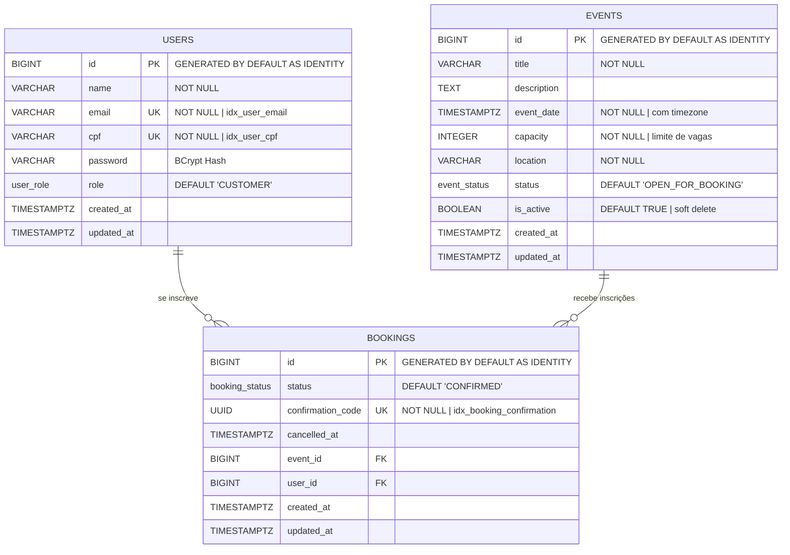

# 🎫 Confirmed Seat | CS-API

**API de gerenciamento de inscrições em eventos técnicos e corporativos, com controle de vagas, fila de espera
automática e proteção contra inscrições duplicadas sob alta concorrência.**


## 📋 Índice

- [Sobre o Projeto](#-sobre-o-projeto)
- [Stack Tecnológica](#️-stack-tecnológica)
- [Modelagem do Banco de Dados](#️-modelagem-do-banco-de-dados)
- [Endpoints da API](#-endpoints-da-api)
- [Como Executar](#-como-executar)
- [Variáveis de Ambiente](#-variáveis-de-ambiente)

## 🚀 Sobre o Projeto

O **Confirmed Seat** é uma API REST para gerenciamento de inscrições em eventos. Um administrador cria um evento
definindo título, data, local e o **número máximo de vagas disponíveis**. Usuários autenticados se inscrevem no evento e
recebem um **código de confirmação único** (UUID v4) que comprova sua inscrição.

O principal desafio técnico endereçado é o **controle de concorrência**: quando múltiplos usuários tentam se inscrever
simultaneamente nas últimas vagas disponíveis, o sistema garante que o limite seja respeitado com precisão, sem
duplicatas e sem inscrições além da capacidade.

> 💡 O `confirmation_code` (UUID v4) é o identificador público da inscrição, utilizado para validação de entrada no
> evento sem expor o ID sequencial interno do banco.

## 🛠️ Stack Tecnológica

| Camada          | Tecnologia                     |
|-----------------|--------------------------------|
| Linguagem       | Java 17                        |
| Framework       | Spring Boot 3                  |
| Persistência    | Spring Data JPA + Hibernate    |
| Banco de Dados  | PostgreSQL 16+ (Dockerized)    |
| Migrações       | Flyway                         |
| Segurança       | Spring Security + JWT + BCrypt |
| Documentação    | SpringDoc OpenAPI (Swagger UI) |
| Containerização | Docker & Docker Compose        |

## 🗄️ Modelagem do Banco de Dados

### Diagrama Entidade-Relacionamento



### ENUMs

```
user_role        → ADMIN | CUSTOMER
event_status     → OPEN_FOR_BOOKING | FINISHED
booking_status   → CONFIRMED | CANCELLED | WAITING
```

### Índices

| Índice                     | Tabela     | Coluna              | Tipo   |
|----------------------------|------------|---------------------|--------|
| `idx_user_email`           | `users`    | `email`             | B-Tree |
| `idx_user_cpf`             | `users`    | `cpf`               | B-Tree |
| `idx_booking_confirmation` | `bookings` | `confirmation_code` | B-Tree |

## 📡 Endpoints da API

> A documentação interativa completa está disponível via **Swagger UI** em `http://localhost:8080/swagger-ui/index.html`
> após subir a aplicação.

### 🔑 Auth

| Método | Endpoint         | Acesso  | Descrição                     |
|--------|------------------|---------|-------------------------------|
| `POST` | `/auth/register` | Público | Cadastro de novo usuário      |
| `POST` | `/auth/login`    | Público | Autenticação e geração do JWT |

### 👤 Users

| Método | Endpoint    | Acesso      | Descrição                    |
|--------|-------------|-------------|------------------------------|
| `GET`  | `/users/me` | Autenticado | Dados do usuário autenticado |

### 📅 Events

| Método   | Endpoint              | Acesso      | Descrição                                    |
|----------|-----------------------|-------------|----------------------------------------------|
| `POST`   | `/events`             | `ADMIN`     | Cria um novo evento (Status inicial: `OPEN`) |
| `GET`    | `/events`             | Autenticado | Lista eventos ativos e disponíveis           |
| `GET`    | `/events/{id}`        | Autenticado | Detalha um evento e vagas disponíveis        |
| `PUT`    | `/events/{id}`        | `ADMIN`     | Atualiza informações gerais do evento        |
| `PATCH`  | `/events/{id}/status` | `ADMIN`     | Altera status (ex: `OPEN` para `FINISHED`)   |
| `DELETE` | `/events/{id}`        | `ADMIN`     | Desativa o evento (soft delete)              |

### 📝 Inscrições (Bookings)

| Método   | Endpoint                       | Acesso      | Descrição                                  |
|----------|--------------------------------|-------------|--------------------------------------------|
| `POST`   | `/bookings`                    | `CUSTOMER`  | Realiza inscrição em um evento             |
| `GET`    | `/bookings/me`                 | `CUSTOMER`  | Lista inscrições do usuário autenticado    |
| `GET`    | `/bookings/{confirmationCode}` | Autenticado | Busca inscrição pelo código de confirmação |
| `DELETE` | `/bookings/{confirmationCode}` | `CUSTOMER`  | Cancela uma inscrição e libera vaga        |

## 🚀 Como Executar

### Pré-requisitos

- Java 17
- Docker e Docker Compose
- OpenSSL

### 1. Gerar as chaves RSA

A aplicação usa a chave privada para assinar os tokens JWT e a chave pública para validá-los. Gere ambas no caminho
esperado pela aplicação:

```bash
mkdir -p src/main/resources/certs
openssl genpkey -algorithm RSA -out src/main/resources/certs/authz.pem -pkeyopt rsa_keygen_bits:2048
openssl pkey -in src/main/resources/certs/authz.pem -pubout -out src/main/resources/certs/authz.pub
```

A pasta `src/main/resources/certs/` é ignorada pelo Git e precisa existir localmente antes de iniciar a API. Não
compartilhe nem versione a chave privada `authz.pem`.

### 2. Iniciar o banco de dados

Na raiz do projeto, execute:

```bash
docker compose up -d db
```

O PostgreSQL ficará disponível na porta `5433` da máquina local.

### 3. Iniciar a aplicação

Com o banco em execução e as chaves geradas, inicie a API:

```bash
./mvnw spring-boot:run
```

A API estará disponível em `http://localhost:8080`. A documentação interativa do Swagger pode ser acessada em
`http://localhost:8080/docs`.

## ⚙️ Variáveis de Ambiente

| Variável      | Valor padrão                                                      | Descrição                                      |
|---------------|-------------------------------------------------------------------|------------------------------------------------|
| `DB_URL`      | `jdbc:postgresql://localhost:5433/confirmed_seat?sslmode=disable` | URL JDBC usada pela API para conectar ao banco |
| `DB_USERNAME` | `postgres`                                                        | Usuário do PostgreSQL                          |
| `DB_PASSWORD` | `postgres`                                                        | Senha do PostgreSQL                            |

O Docker Compose também usa `DB_USERNAME` e `DB_PASSWORD` para configurar o usuário e a senha do banco. Para
personalizar os valores, crie um arquivo `.env` na raiz do projeto, por exemplo:

```dotenv
DB_USERNAME=postgres
DB_PASSWORD=uma-senha-local
DB_URL=jdbc:postgresql://localhost:5433/confirmed_seat?sslmode=disable
```

O Compose carrega `.env` automaticamente. Ao executar a API pelo Maven fora do Docker, exporte as variáveis no ambiente
do processo ou carregue o arquivo no shell antes de iniciar a aplicação:

```bash
set -a
source .env
set +a
./mvnw spring-boot:run
```

O arquivo `.env` e as chaves em `src/main/resources/certs/` são ignorados pelo Git; não versione credenciais nem a chave
privada.